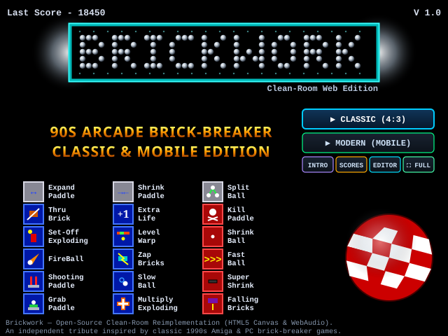
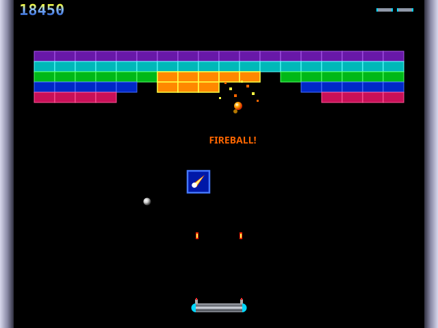
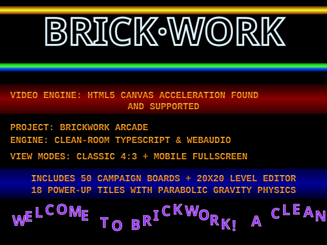
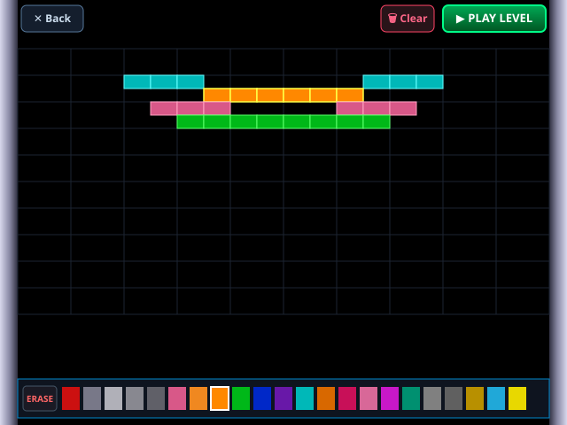
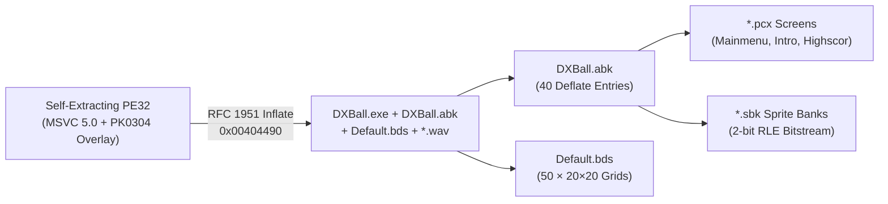

<div align="center">

# 🧱 Brickwork — A Reverse Engineering Project

**A clean-room HTML5 Canvas & WebAudio tribute to 1990s PC & Amiga brick-breaker games, built from binary specifications recovered with [REA](https://github.com/morluto/rea) and [Ghidra](https://github.com/nationalsecurityagency/ghidra).**

<br />

<a href="https://alxmtzr.github.io/brickwork/">
  
</a>

<br /><br />

[](https://alxmtzr.github.io/brickwork/)
[](https://github.com/morluto/rea)
[](https://github.com/nationalsecurityagency/ghidra)
[](#ai-models--reverse-engineering-toolchain)
[](#ai-models--reverse-engineering-toolchain)

</div>

---

## 👋 About This Project

This project is **my very first attempt at using [REA (Reverse Engineer Anything)](https://github.com/morluto/rea) to reverse engineer a real compiled binary** from scratch and turn those findings into a modern, playable web application.

Rather than extracting and shipping copyrighted art or audio files, the goal was a true **clean-room reverse engineering workflow**:
1. Inspect a classic late-1990s Windows game binary and its custom archive formats using **[REA](https://github.com/morluto/rea)** and **[Ghidra](https://github.com/nationalsecurityagency/ghidra)**.
2. Understand how the original executable was structured—its state machine, custom sprite/animation bank containers, physics loop, power-up spawn probabilities, and start-screen animations.
3. Reimplement the entire experience from scratch in **zero-dependency TypeScript, HTML5 Canvas, and WebAudio**, adding a **Modern Smartphone Fullscreen (PWA) Mode** alongside the **Classic 4:3 Mode**.

---

## 📸 Screenshots

<div align="center">
<table>
  <tr>
    <td align="center" width="50%">
      
      <br />
      <sub><b>Start Screen</b> — 46×7 orbiting 3D silver-ball dot-matrix, mode selector, 3×6 legend of all 18 power-up tiles, and tilted 3D checkered sphere.</sub>
    </td>
    <td align="center" width="50%">
      
      <br />
      <sub><b>Classic Gameplay (640×480)</b> — 3D recessed bricks, chain-reaction explosive clusters, twin laser turrets, FireBall trails, and falling 32×32 power-up tiles.</sub>
    </td>
  </tr>
  <tr>
    <td align="center" width="50%">
      
      <br />
      <sub><b>Intro / Credits Splash</b> — Oscillating gold &amp; green/blue raster bars, outlined logo, and sine-wave scrolling 3D beveled purple text.</sub>
    </td>
    <td align="center" width="50%">
      
      <br />
      <sub><b>Built-In 20×20 Level Editor</b> — Paint with all 22 brick types (including explosive &amp; multi-hit armor) and jump straight in via <code>▶ PLAY LEVEL</code>.</sub>
    </td>
  </tr>
</table>
</div>

---

## 🏆 Credit to the Original Game

**Brickwork** is an independent clean-room tribute inspired by:
* ***DX-Ball* (v1.09, 1996–1998)** — created and programmed by **Michael P. Welch**, with 3D rendered graphics by **Seumas McNally** (Longbow Digital Arts).
* ***MegaBall* (1991–1995)** — the legendary Commodore Amiga brick-breaker created by **Ed and Al Mackey**, which inspired *DX-Ball* (including the iconic Amiga red-and-white checkered Boing Ball homage).

All graphics in this repository are drawn procedurally via the HTML5 `<canvas>` 2D API, all sound effects are synthesized in real time via the browser's `AudioContext`, and all 50 campaign boards are generated algorithmically.

---

## 🔬 AI Models & Reverse Engineering Toolchain

| Stage | Tool / Model | Role in Project |
| :--- | :--- | :--- |
| **RE Workflow & Binary Triage** | **[REA (Reverse Engineer Anything)](https://github.com/morluto/rea)** | Orchestrated the reverse-engineering workflow, binary format identification, archive container inspection, strings/imports triage, and deep static analysis queries. |
| **Static Decompilation Engine** | **[NSA Ghidra](https://github.com/nationalsecurityagency/ghidra)** | Provided headless x86 `PE32` disassembly, control-flow graph recovery, cross-references, and C decompilation under REA's session management. |
| **Decompilation & Spec Analysis** | **Opus 5.5** | Analyzed the decompiled C functions (`0x401000`–`0x40ba40`), decoded the custom archive/sprite container formats, and documented the exact physics and state-machine specifications. |
| **Clean-Room Implementation** | **Gemini 4 Argon** | Built the TypeScript/Canvas/WebAudio engine, procedural 3D tile & sphere renderers, 50-board generator, interactive 20×20 Level Editor, and Dual-Mode Mobile Fullscreen PWA support. |

---

## 🧬 How the Original Game Was Programmed (Reverse Engineering Findings)

Using **[REA](https://github.com/morluto/rea)** and **[Ghidra](https://github.com/nationalsecurityagency/ghidra)**, we inspected the original 1998 binary and uncovered how it was engineered:

### 1. Compiler, Language & DirectX Stack
* **Language & Compiler:** Written in **C/C++** and compiled as a 32-bit Windows Portable Executable (`PE32` Intel 80386, image base `0x00400000`) using **Microsoft Visual C++ 5.0** (`Linker 5.0`).
* **Graphics (`DDRAW.dll`):** Uses **Microsoft DirectDraw** in exclusive fullscreen mode (`640×480×16-bit` HighColor RGB565 surfaces) with hardware-accelerated blitting and double-buffered page flipping.
* **Audio (`DSOUND.dll` & `WINMM.dll`):** Uses **Microsoft DirectSound** secondary sound buffers (`DuplicateSoundBuffer`, `SetFrequency`, `SetPan`) to mix overlapping PCM `.wav` sound effects with dynamic stereo panning based on the horizontal X coordinate of brick/paddle impacts.

### 2. Custom Self-Extractor & Asset Container Formats
The original distribution used a custom multi-layer packaging pipeline:
1. **Self-Extracting Outer Stub (`0x00414800` overlay):** A custom ZIP-like archive using local header magic `'P','K',3,4` (`PK0304`-variant) with raw **RFC 1951 Deflate** streams (decompressed via `0x00404490`) and custom `0xaa55` (`43605`) trailing descriptors.
2. **`DXBall.abk` (Animation Bank):** A custom container starting with a 4-byte little-endian entry count (`40` entries), followed by an entry table of `{ name[16], offset_u32, compressed_size_u32, uncompressed_size_u32 }` records storing Deflate-compressed `.pcx` and `.sbk` assets.
3. **`.sbk` (Sprite Bank — `mball2.sbk`, `mainmenu.sbk`, `Chisel2.sbk`, `Font1.sbk`, `Font2.sbk`):**
   * `70-byte` header + `768-byte` RGB palette (`256 × 3` bytes) + `uint32` sprite count.
   * Each sprite has a `24-byte` header (`width`, `height`, `x_offset`, `y_offset`, `flags`, `data_size`) followed by a **custom 2-bit RLE bitstream** (`00` = literal pixel, `01` = 4-bit run + pixel, `10` = 8-bit run + pixel, `11` = 16-bit run + pixel).
4. **`Default.bds` (Board Data File):** Exactly `20,000` bytes containing `50` consecutive boards of `400` bytes each (`20 columns × 20 rows`), where byte values `0x00..0x16` index the brick type palette (`0x08` = explosive chain-reaction brick).



### 3. Core Engine Architecture (`DXBall.exe`)
* **Master State Dispatcher (`0x40ab10`):** Drives 5 primary states:
  * `State 1`: Active Gameplay (`0x406050`)
  * `State 4`: Intro / Credits Splash (`0x40a0b0`, `0x40a510`, `0x40a850`, `0x40a6c0`) — renders oscillating raster bars and a sine-wave 3D beveled text scroller.
  * `State 5`: Start / Main Menu Screen (`0x40ae80`, `0x40af80`, `0x40b2d0`, `0x40ba40`)
  * `State 6`: High Scores Screen (`0x408cf0`)
  * `State 7`: Built-in 20×20 Board Editor (`0x4094a0`)
* **Orbiting Silver-Ball Dot-Matrix (`0x40b2d0` & `0x40ba40`):**
  * Initializes a `41×7` bitmap inside the top cyan spotlight frame (`x: 112..530, y: 37..115`).
  * Every `50ms`, background `0` cells draw a single orbiting cyan pixel dot while foreground `1` cells draw 3D silver balls orbiting in phase-shifted `4×3` ellipses (`30°` step per tick).
* **18 Power-Up Spawn & Parabolic Physics (`0x406ef0` & `0x407420`):**
  * Enforces a **1-active-capsule rule**: a new power-up tile only drops if no tile is currently active on screen (`DAT_00431fb0 == 0`).
  * **18 distinct 32×32 3D beveled tiles** across 3 categories (Grey, Blue, Red). Rare bonuses (`0` *Extra Life* and `1` *Level Warp*) undergo a secondary `1-in-5` roll and convert into `13` (*Kill Paddle*) `80%` of the time.
  * Spawned tiles inherit the ball's velocity vector (`vx`, `vy`), accelerate downward under gravity every `20` ticks, and bounce off the left, right, and top walls.

---

## 🚀 What I Built in *Brickwork*

1. **100% Clean-Room TypeScript + HTML5 Canvas + WebAudio Engine**
   * Zero external runtime dependencies and zero copied binary assets (`~15 kB` gzipped bundle).
   * Clean-room **RFC 1951 Deflate** decompressor ([`inflate.ts`](./src/archive/inflate.ts)), `.abk`/`.sbk`/`.pcx` format parsers ([`abk.ts`](./src/archive/abk.ts), [`sbk.ts`](./src/archive/sbk.ts), [`pcx.ts`](./src/archive/pcx.ts)), and real-time **WebAudio retro synth** ([`sound.ts`](./src/game/sound.ts)).
2. **Dual Play Modes: Classic (4:3) & Modern (Mobile Fullscreen Portrait)**
   * **Classic Mode (`640×480` 4:3):** Preserves the exact desktop geometry, brick proportions, and ball speed of late-90s CRT monitors.
   * **Modern Mode (Smartphone Fullscreen + PWA):** Dynamically adapts the playfield to vertical smartphone screens (Android & iOS), scales ball velocity to match the taller vertical travel distance, supports 1:1 touch tracking, and includes a Web App Manifest + fullscreen/PWA installer so you can play with zero browser bars.
3. **Complete Start Screen, Intro Splash & All 18 Power-Ups**
   * Orbiting 3D silver-ball dot-matrix spelling **`BRICKWORK`**, complete 3×6 legend of all 18 procedurally drawn 3D beveled power-up tiles, tilted 3D checkered sphere, and the sine-wave 3D scroller Intro screen.
4. **Interactive 20×20 Level Editor with Instant Playtesting**
   * Paint custom boards using all 22 brick styles (including chain-reaction explosive bricks and multi-hit armor) and click **`▶ PLAY LEVEL`** to test your creation immediately.

---

## 🛠️ Local Development

```bash
# Install dependencies
npm install

# Start local development server
npm run dev

# Typecheck and build production bundle
npm run build

# Run unit tests (RFC 1951 inflate & CRC32 verification)
npm test
```
